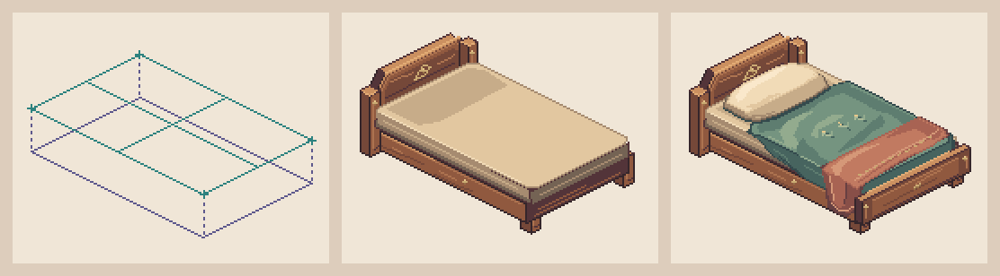

# 쑥빛 이불 침대 · 2:1 사선 제작 가이드

왼쪽부터 바닥·매트리스 투영선, 침대 뼈대, 완성본입니다. 모든 단계는 같은 캔버스에서 최근접 2배로 표시했습니다.

[PixelPen 원본](sage-quilt-bed.pxpen) · [투명 PNG](sage-quilt-bed.png) · [4배 확대](sage-quilt-bed-4x.png)

## 첨부 장면의 투영

| 확인한 부분 | 화면에서 읽히는 방향 | 이 작업본의 도트 규칙 |
| --- | --- | --- |
| 발치대의 긴 윗선 | 오른쪽으로 갈수록 올라갑니다. | 오른쪽 2px마다 위로 1px |
| 침대 옆 프레임 | 발치 쪽으로 갈수록 오른쪽 아래로 내려갑니다. | 오른쪽 2px마다 아래로 1px |
| 목재 기둥 | 기둥의 윗점과 아랫점이 수직으로 정렬됩니다. | 같은 x에서 위아래로 찍기 |

첨부 JPG에서 곡선과 주름을 빼고 긴 직선만 보면 두 바닥축의 기울기는 약 ±0.5입니다. 이 작업본에서는 두 축을 정확히 2:1로 그렸습니다. 픽셀아트에서 흔히 아이소메트릭이라고 부르는 **2:1 디메트릭 투영**이며, 사선 각도는 약 ±26.6°입니다. 이 수치는 이미지에서 읽은 기울기를 작업 규칙으로 옮긴 값입니다.

## PixelPen에서 따라 찍기

캔버스는 **176×140px**, 완성 실루엣은 **157×113px**입니다. `(0, 0)`은 왼쪽 위입니다.

| 모서리 | 바닥 | 매트리스 기준면 |
| --- | --- | --- |
| 머리 쪽 왼쪽 A | `(10, 77)` | `(10, 53)` |
| 머리 쪽 오른쪽 B | `(70, 47)` | `(70, 23)` |
| 발치 오른쪽 C | `(166, 95)` | `(166, 71)` |
| 발치 왼쪽 D | `(106, 125)` | `(106, 101)` |

1. **투영선을 만듭니다.** A→B의 변화는 `(+60, −30)`, A→D는 `(+96, +48)`입니다. 1px 연필로 2px씩 이어 찍고 줄을 한 칸 옮깁니다. 반대편 두 변에도 같은 간격을 씁니다. 네 점을 위로 24px 복제하면 매트리스 기준면입니다. 숨겨진 `08 Construction` 레이어를 켜면 보라색 바닥선과 청록색 매트리스 기준면을 볼 수 있습니다.
2. **목재와 매트리스를 쌓습니다.** `01–03` 레이어를 보며 목재의 긴 가로재, 수직 기둥, 매트리스 윗면과 두께를 먼저 찍습니다. 목재의 가장 어두운 톤은 틈과 접점, 밝은 톤은 받는 빛이 드러나는 윗모서리에 둡니다.
3. **침구의 겹침을 만듭니다.** `04–07` 레이어를 차례로 켭니다. 베개는 머리판 아래와 이불의 윗부분을 가립니다. 적갈색 천은 매트리스 위에서 폭 축을 따라가다가 왼쪽 모서리에서 아래로 꺾입니다. 발치대는 침구의 끝을 가립니다. 두 다리는 프레임 안쪽에 두어 발치대 아래로 짧게 보이게 합니다.
4. **재질에 따라 밝은 픽셀의 모양을 바꿉니다.** 목재에는 1px 밝은 띠를, 베개에는 넓고 밝은 덩어리를, 이불에는 짧게 연결된 주름을 씁니다. 큰 천 면의 밝기를 먼저 맞춘 뒤 씨앗 자수와 황동 장식을 추가합니다. 1배에서는 면과 가림을, 4배에서는 대각선 계단과 투명 경계를 확인합니다.

| 재질 | 큰 색 면 | 어두운 면 | 밝은 면 |
| --- | --- | --- | --- |
| 호두나무 | `#90593F` | `#533439` | `#CB9060` |
| 오트밀색 린넨 | `#F1DBB7` | `#C7AC89` | `#FAE8CB` |
| 쑥빛 이불 | `#759480` | `#47645F` | `#93AB8E` |
| 적갈색 직물 | `#C17A61` | `#884F48` | `#D59878` |

같은 투영으로 방을 그릴 때도 바닥 줄눈, 침대 옆 협탁, 러그의 평행변을 이 두 축에 맞춥니다. 이 작업본의 카메라 기준은 첨부 장면을 분석하기 위한 독립 2D 가구 스터디입니다.
