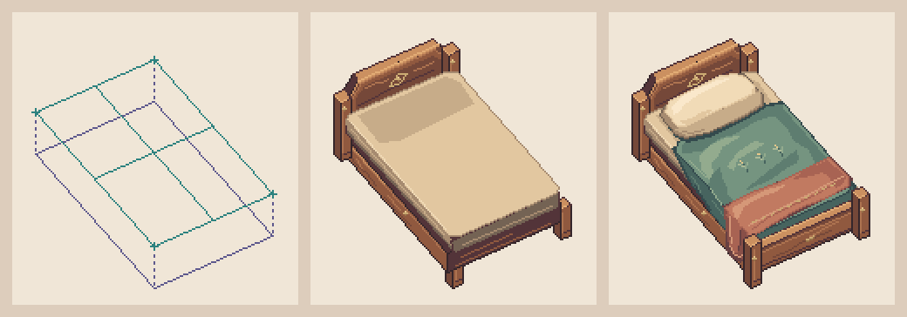

# 쑥빛 이불 침대 · PixelPen 가구 제작 가이드

왼쪽부터 바닥과 매트리스의 투영선, 목재 프레임과 매트리스, 침구와 발치대까지 올린 결과입니다. 세 그림은 같은 캔버스를 최근접 2배로 표시했습니다.

[PixelPen 원본](sage-quilt-bed.pxpen) · [투명 PNG 1배](sage-quilt-bed.png) · [최근접 PNG 4배](sage-quilt-bed-4x.png)

## 위치 브룩 장면에서 가져온 원리

| 장면에서 보이는 것 | 새 침대에 적용한 방법 |
| --- | --- |
| 윗면의 폭은 오른쪽 위로, 침대 길이는 오른쪽 아래로 향합니다. 프레임과 침구의 평행변은 같은 방향을 따르고 기둥은 수직입니다. | 바닥 네 점을 먼저 찍고 화면 위로 같은 높이만큼 옮겨 매트리스 높이를 잡았습니다. 머리판의 윗선과 발치대 솔기를 폭 축에 맞췄습니다. |
| 베개가 머리판 아래를 가리고, 발치 프레임이 침구의 끝을 일부 가립니다. 발치 장식천은 모서리에서 꺾여 측면으로 내려갑니다. | 머리판, 매트리스, 이불, 베개, 발치 천, 발치대를 별도 레이어로 쌓았습니다. 옆으로 떨어지는 천에는 한 단계 어두운 적갈색을 썼습니다. |
| 나무의 얇은 밝은 띠와 천의 넓은 중간톤이 다르게 읽힙니다. 가장 어두운 갈색은 베개 밑, 목재 접합부처럼 가려지는 지점에 모여 있습니다. | 목재의 윗모서리에 끊어지는 밝은 선을 두고, 이불에는 연결된 주름 덩어리 몇 개만 배치했습니다. 재질 경계에는 각각 짙은 쑥빛과 갈색을 썼습니다. |

첨부 JPG에서 확인할 수 있는 것은 화면상 각도와 색 덩어리의 관계입니다. 아래 수치는 이 새 침대의 작업 좌표입니다.

## PixelPen에서 따라 찍기

**캔버스 164×168px · 실루엣 137×144px · 바닥 점유 1.25×2칸**

[아르카나 정면 3/4 정사영](../../../docs/roles/WORLD_BUILDING.md#공통-투영과-크기)을 기준으로 침대 자체를 32° 돌렸습니다. 좌표는 왼쪽 위가 `(0, 0)`이고 오른쪽과 아래가 양수입니다. 픽셀의 계단 간격은 모서리의 두 끝점에서 결정합니다.

| 모서리 | 바닥 | 매트리스 기준면 |
| --- | --- | --- |
| 머리 쪽 왼쪽 A | `(13, 81)` | `(13, 57)` |
| 머리 쪽 오른쪽 B | `(81, 51)` | `(81, 27)` |
| 발치 오른쪽 C | `(149, 128)` | `(149, 104)` |
| 발치 왼쪽 D | `(81, 158)` | `(81, 134)` |

1. **네 모서리를 찍습니다.** 1px 연필로 A–B–C–D를 잇습니다. 폭 방향은 `(+68, −30)`, 길이 방향은 `(+68, +77)`입니다. 복제한 윗면을 24px 올리고, 대응되는 점을 수직으로 이으면 다리와 기둥을 세울 자리가 나옵니다. 원본의 숨겨진 `08 Construction` 레이어에서 보라색 바닥선과 청록색 매트리스 기준선을 켜 볼 수 있습니다.
2. **목재와 매트리스로 부피를 만듭니다.** `01–03` 레이어만 켜고, 나무 프레임 위에 오트밀색 매트리스를 얹습니다. 매트리스의 윗면과 두께에 다른 명도를 배정하고, 목재의 가는 윗모서리 밝은색을 한 번에 한 구간씩 찍습니다. 평행해야 하는 목재 모서리는 선을 복제해 위치를 옮기면 계단이 맞습니다.
3. **천을 겹쳐 가림을 확인합니다.** `04–06`에서 이불 위에 베개를 얹고 발치 천을 겹칩니다. 베개 아랫변은 어둡게 두고, 윗면의 밝은 덩어리 하나를 가장 크게 둡니다. 발치 천이 왼쪽으로 접히는 지점에는 한 단계 어두운 색을 붙이고 밝은 줄을 아래로 짧게 꺾습니다. `07`을 켜면 낮은 발치대가 이불 끝을 가립니다.
4. **표면에 필요한 픽셀만 남깁니다.** 쑥빛 윗면에는 2–4px씩 이어지는 밝은 주름, 중앙에는 작은 씨앗 자수 세 송이를 찍었습니다. 황동은 기둥과 발치대의 몇 점에만 반복했습니다. 1배에서 먼저 베개·이불·프레임이 각각 읽히는지 봅니다. 4배에서는 평행변 계단, 천의 접힘, 알파 가장자리를 확인합니다.

## 같은 분위기로 다음 가구를 그릴 때

| 재질 | 큰 면 | 어두운 면 또는 접점 | 작은 밝은 면 |
| --- | --- | --- | --- |
| 호두나무 | `#90593F` | `#533439`, 접점 `#35262B` | 윗모서리 `#CB9060` |
| 오트밀색 린넨 | `#F1DBB7` | 베개 옆면 `#C7AC89` | 볼록한 중심 `#FAE8CB` |
| 쑥빛 이불 | `#759480` | 접힌 옆면 `#47645F` | 주름 `#93AB8E` |
| 적갈색 직물 | `#C17A61` | 접힌 옆면 `#884F48` | 솔기 주변 `#D59878` |

- 의자·탁자·선반에도 같은 화면 축과 위쪽에서 오는 빛을 유지합니다. 먼저 윗면, 보이는 옆면, 바닥에 닿는 부분을 구분합니다.
- 씬에서는 가구마다 가장 밝거나 채도 높은 장식을 한두 곳에 둡니다. 목재는 모서리의 길고 얇은 선, 천은 폭이 있는 짧은 주름처럼 재질에 따라 밝은 픽셀의 모양을 바꿉니다.
- 스프라이트는 최근접 정수 배율로 비교합니다. 침대가 놓일 방에서는 문·인물과 같은 배율에서 크기, 네 다리의 접지, 걸어 다닐 때의 가림을 확인합니다.

이 작업본은 가구 제작 연습용입니다. PixelPen에서 다시 연 원본의 보이는 7개 레이어를 합성해 PNG를 출력했으며, 투명도는 0%와 100%입니다.
