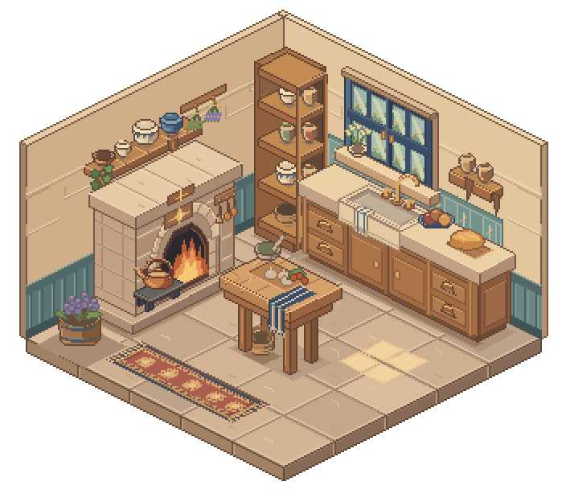

# 아르카나 5×5 주방 · 2:1 보정

[PixelPen 편집 원본](kitchen-5x5-2to1-polished.pxpen) · [352×312 투명 PNG](kitchen-5x5-2to1-polished.png) · [최근접 2배](kitchen-5x5-2to1-polished-2x.png)

## 작업 기준과 범위

사용자가 확정한 [2:1 실내 스터디 방식](../../../docs/roles/WORLD_BUILDING.md#21-실내-스터디)을 이전 주방에 적용했습니다. 침대에서 맞춘 것처럼 바닥과 가구의 두 사선은 오른쪽 2px마다 위나 아래로 1px 이동하고, 다리와 기둥은 수직입니다. 작업 범위는 주방의 편집 원본과 이미지 출력입니다.

- 기준 원본은 [주방 보정 전 PixelPen 파일](kitchen-5x5-refined.pxpen)과 [기존 배치](kitchen-layout-refined.json)입니다. 5×5 바닥, 방의 외곽, 가구의 점유 범위와 통로, 화덕·싱크대·창문의 위치를 유지했습니다.
- 북쪽 모서리는 식료품장, 왼쪽 벽은 화덕, 오른쪽 벽은 창과 싱크대입니다. 중앙 작업대 앞에서 세 방향으로 접근하는 바닥이 열려 있습니다. 캔버스의 후면 바닥 꼭짓점은 `(176, 130)`이고, 타일 한 칸의 화면 크기는 64×32px입니다.

## 수정한 부분

| 부위 | 적용 |
| --- | --- |
| 중앙 작업대 | 네 다리를 상판 안쪽으로 넣고, 가로재가 다리의 윗부분을 가리게 했습니다. 천의 접힘과 작업대 아래 바구니 위치를 살렸습니다. |
| 수납장 | 몸통 아래에 더 좁고 어두운 받침을 넣어 바닥에 닿는 면과 문판을 구분했습니다. |
| 바닥 접지 | 작업대 아래의 넓은 그림자를 줄이고 다리 끝에 짧은 그림자를 찍었습니다. 화덕 받침과 수납장 아래에는 닿는 방향을 따라 낮은 명암을 넣었습니다. |
| 찬장과 벽 선반 | 그릇의 밑굽을 각 선반의 윗면 안에 배치했습니다. 찬장의 앞기둥이 그 뒤의 그릇을 가리고, 흰 그릇과 파란 그릇 사이에는 여백을 뒀습니다. |

## 편집과 확인

작업대, 개수대와 수납장, 바닥 접지에 이어 찬장과 두 벽 선반의 그릇을 보정했습니다. 숨겨진 `확인용 · 5×5 타일 격자` 레이어를 켜면 바닥 줄눈과 가구 모서리의 방향을 볼 수 있습니다. 수정은 원본 사본의 PixelPen 레이어에 저장했습니다.

다시 연 편집 원본에서 15개 레이어와 격자 숨김을 확인하고, 투명 PNG로 출력했습니다. 1배에서 방의 전체 구조와 가림을, 2배에서 작업대 다리와 수납장 받침의 접점을 확인했습니다. 선반은 부분 확대에서 그릇의 밑굽과 앞기둥의 가림을 확인했습니다. 출력 이미지의 투명 외곽은 기존 주방과 같습니다.

## Godot 확인용 씬

[독립 주방 씬](../../../godot-arcana/scenes/studies/kitchen-iso-2to1/kitchen_iso.tscn)은 PixelPen의 바닥·벽과 가구 다섯 묶음을 원본 크기로 배치합니다. 다섯 가구의 바닥 점유는 기존 배치 JSON에서 가져왔습니다. 주인공은 본편의 v12 표시를 사용하고, 발 위치와 가구 바닥면의 앞쪽 경계에 따라 가림 순서를 정합니다.

씬에 지정된 여섯 이미지 영역을 합성해 주방 출력과 픽셀 단위로 일치하는 것을 확인했고, 이동 스크립트 구문을 검사했습니다. 재생 확인은 Godot에서 이 씬을 열고 F6으로 실행한 다음 방향키로 작업대 앞과 뒤를 돌아보면 됩니다.
